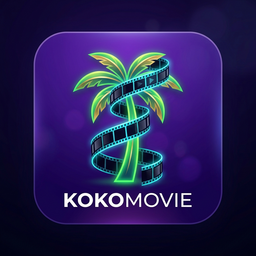
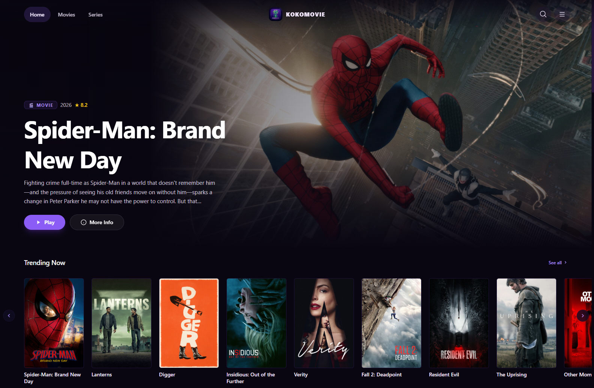
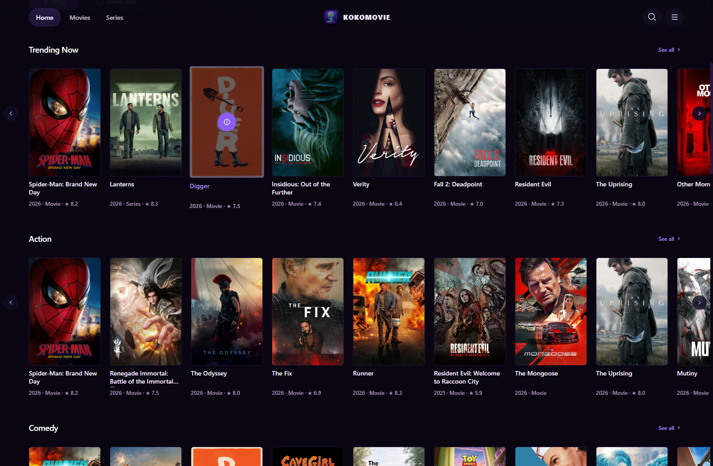
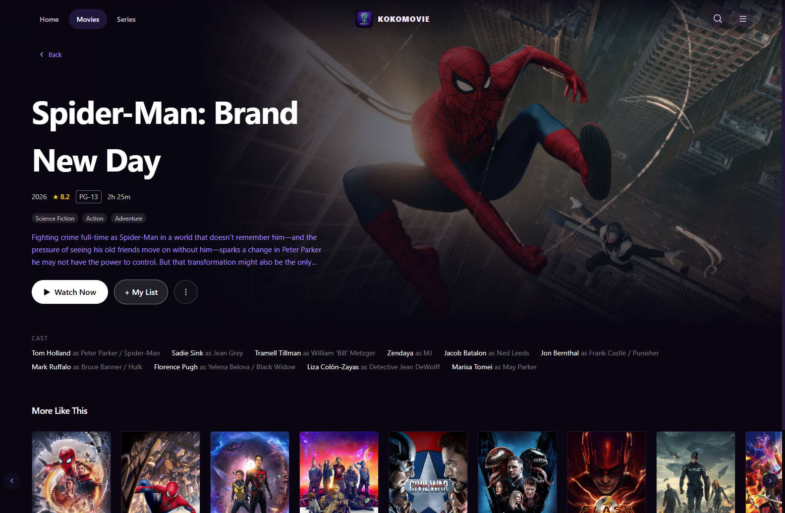
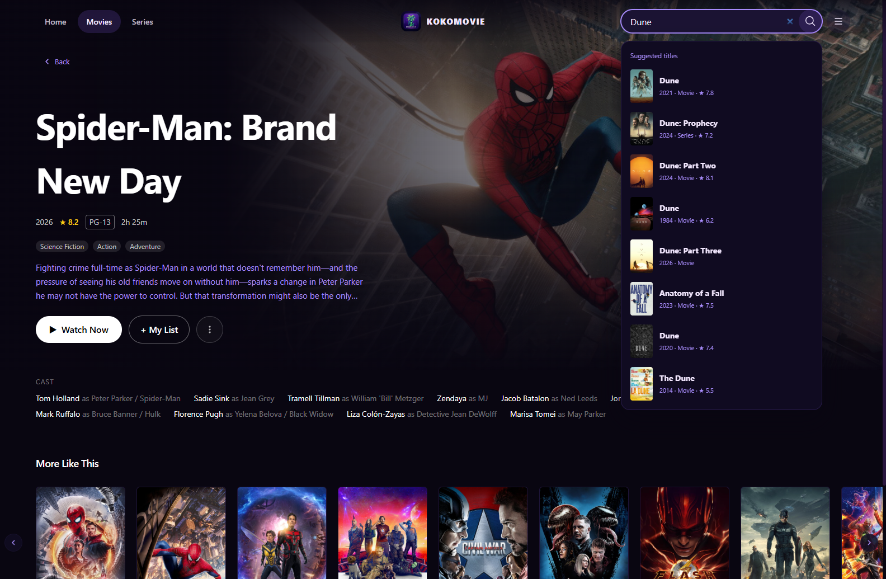

<div align="center">



# KokoMovie

**A local movie and TV library with catalog discovery, playback and offline files.**

[](https://github.com/Noobiez16/KokoMovie/releases)
[](#download)
[](#automatic-updates)

</div>

---

## Download

Pick your system and click to grab the latest version from the
**[Releases page](https://github.com/Noobiez16/KokoMovie/releases/latest)**:

<div align="center">

[](https://github.com/Noobiez16/KokoMovie/releases/latest)
&nbsp;
[](https://github.com/Noobiez16/KokoMovie/releases/latest)
&nbsp;
[](https://github.com/Noobiez16/KokoMovie/releases/latest)

[](https://github.com/Noobiez16/KokoMovie/releases/latest)

Linux downloads are published separately for **x64/amd64** and **ARM64/aarch64**. Choose the
artifact whose architecture matches `uname -m` (`x86_64` → `x64`, `aarch64` → `arm64`).

</div>

macOS 12+ downloads have separate **Intel (`mac-x64`)** and **Apple Silicon (`mac-arm64`)**
DMG/ZIP files. Open the DMG and drag KokoMovie into Applications. These builds are **ad-hoc
signed, not Apple-notarized**. Verify the checksum and use macOS's per-app approval flow if
Gatekeeper blocks it; see [Apple's instructions](https://support.apple.com/102445). Mac updates
are installed manually from Releases, with the local library preserved.

---

## What is KokoMovie?

**KokoMovie 2.1.0** adds native macOS packages, personal suggestions, stronger CAM notices,
provider recovery and real 4K quality choices. The desktop composition includes
top navigation with the original centered logo, cinematic title artwork, a landscape
Continue Watching row, genre navigation and keyboard-operated season tabs. The clean header
has no separator line; My Library joins saved titles and viewing history under one menu entry.
Search expands left in the header and suggests titles below the field as you type, keeping
the current page until you select a detail. It contracts right when dismissed; an empty or
one-character field shows no instructional panel. Existing `/search` links retain filters and pagination.
Hero/detail artwork shows its complete frame on large and ultrawide screens, with fluid height
and higher-resolution trusted artwork when needed. Playback exposes real 4K / 1080p / 720p choices;
unavailable variants are disabled, and direct videos report their decoded quality.
The existing purple palette and logo bytes are preserved;
motion respects the system's reduced-motion preference. Login and profiles are not added.
It also adds permanent completed downloads, controlled
transfer teardown and a stricter renderer script policy.
The `v2.1.0` tag runs installer builds and publication through
[GitHub Actions](https://github.com/Noobiez16/KokoMovie/actions/workflows/electron-release.yml).
Downloads become available when the release workflow succeeds. See
[current state](docs/current-state.md) for verified scope.

KokoMovie brings catalog discovery, local library records and playback into one desktop
interface. Search titles, review their details, choose a source or play saved media.
External catalog access uses your TMDB credential; source availability depends on providers.

- **A real catalog** — posters, ratings, cast, and descriptions for thousands of titles
- **Source discovery** — prefers available non-CAM sources at 4K, 1440p, 1080p, then 720p; manual selection, visible errors and retries remain available
- **Built-in player** — quality options, subtitles, Picture-in-Picture, and keyboard shortcuts
- **On-device storage** — watchlists, history, and preferences are stored locally on your machine
- **Picked for You** — suggestions combine explicit Likes, meaningful watch history and My List. Use Like on a title's detail page; suggestions appear on Home after there is enough local interest and related catalog data.
- **Honest source quality** — CAM/TS evidence triggers confirmation and a player warning. Movies with no release evidence show an unverified-source notice; encoded 1080p/4K dimensions alone do not establish a clean release.
- **Watch offline** — completed portable MP4 files stay until you remove them; equal-title downloads receive distinct filenames
- **Release updates** — optional update checks for published builds
- **English, Español, Français** — switch the localised interface in Settings, with no restart
- **Built-in diagnostics** — advanced users can open Developer Tools from the View menu to inspect console errors

---

## Desktop preview

Actual screenshots of KokoMovie 2.0.0 with the live catalog. Titles and artwork change
with catalog availability and the selected interface language.

**Home — featured artwork and trending titles**



<details>
<summary>Explore the catalog galleries, title details and instant search</summary>

**Catalog galleries**



**Title details and recommendations**



**Instant search**



</details>

---

## Automatic Updates

Windows and Linux AppImage builds can check for updates and install them when enabled.
Linux `.deb` packages are updated by installing a newer package. The ad-hoc signed macOS
build uses **Settings → Manual updates → Open downloads**; quit the app and replace it in
Applications with the latest matching architecture. Your library remains in local app data.

---

## Getting Started

1. **Download and install** KokoMovie for your system (buttons above).
2. **Add a free TMDB key** so the catalog fills with movies and shows
   (one-time, 2 minutes — see below).
3. **Browse or search**, click any poster, and press **Watch**. That's it.

### Getting your free TMDB key

KokoMovie uses [TMDB](https://www.themoviedb.org/) (the same free movie database behind
many popular apps) to show posters, titles, and details. It's free and takes a minute:

1. Create a free account at [themoviedb.org](https://www.themoviedb.org/).
2. Go to **[Settings → API](https://www.themoviedb.org/settings/api)** and request a key
   (choose "Developer", non-commercial use — it's instant).
3. Copy your **API Key** or **Read Access Token**.
4. In KokoMovie, open **Settings → API Configuration**, paste the key, and click
   **Validate & Save**. Done — your key is stored securely on your device.

---

## FAQ

**Is it free?** Yes. There are no subscriptions or accounts to pay for.

**Where do the movies come from?** KokoMovie doesn't host any videos. When you press
Watch, it locates a stream from third-party sources — the same ones you'd find browsing
the web — and plays it in its built-in player.

**Do I need the TMDB key?** Yes, to see the catalog. It's free and one-time (steps above).

**Will my data be uploaded anywhere?** No. Your watchlist, preferences, and viewing history are stored locally in an on-device SQLite database.

### Documentation and feedback

Open **Help → Documentation** to read the changelog inside KokoMovie, including while
offline. Use **Help → Send Feedback…** to compose a bug report, feature request, or
improvement. KokoMovie opens GitHub's authenticated issue page for final review and never
stores a GitHub password or access token.

Feedback carries an anonymous installation-local tracking ID. To notify its author after
the work is released, a maintainer closes the GitHub issue and posts a final comment in
this format:

```text
[DONE] Implemented in v1.4.0 (changelog v1.4.0): Brief user-facing explanation of what changed.
```

On a later launch or window focus, that installation displays the explanation, changelog
version, and a link to the completed issue. Only the public issue and its public comments
are checked; no watch history, API keys, or other local library data are transmitted.

---

<details>
<summary><h2>For Developers</h2></summary>

KokoMovie is a fully local Electron + React desktop application. All state (watchlists, settings, playback positions) is managed on-device via SQLite. Metadata is fetched directly from TMDB; streams are located by loading third-party embed pages in a sandboxed hidden window and intercepting the video URL.


### Prerequisites

- Node.js 22+, npm 10+
- A free [TMDB API key](https://www.themoviedb.org/settings/api)

### Run locally

```bash
git clone https://github.com/Noobiez16/KokoMovie
cd KokoMovie
npm install
npm run dev:client
```

This starts the main compiler in watch mode and launches the Electron application on your desktop.
Keep the terminal running and use that KokoMovie window. Opening `http://localhost:5173/`
in a regular browser only serves the development renderer; playback, local records and
settings require Electron's preload connection. Without that connection, the page shows
desktop guidance instead of mounting privileged flows and leaving a blank screen.

### Project structure

```
KokoMovie/
└── client/                 # Electron app
    └── src/
        ├── main/           # Main process (Node.js): providers, stream-extractor, local SQLite DB, IPC
        └── renderer/       # React app (Vite): pages, components, local API connectors
```

### Development commands

| Command | Description |
|---|---|
| `npm run dev:client` | Start the Electron/Vite client locally |
| `npm run build` | Build the production bundle |
| `npm run lint` | Run ESLint |
| `npm run typecheck` | Typecheck renderer, main process and Electron tests |
| `npm test` | Run the deterministic Vitest suite |
| `npm run audit:production` | Production dependency advisory policy |
| `npm run check:licenses` | Distribution licence gate (`-- --report` for the inventory) |
| `npm run vendor:ffmpeg` | Fetch + verify the pinned LGPL FFmpeg for this platform |

### Bundled FFmpeg

FFmpeg is not an npm dependency. `npm run vendor:ffmpeg` obtains a checksum-pinned **LGPL-3.0**
build into `client/vendor/ffmpeg/<platform>-<arch>/` and refuses any binary configured with
GPL-only components. Linux/Windows use pinned BtbN archives; macOS compiles unmodified official
FFmpeg 8.1.2 source on a matching native Mac using Xcode Command Line Tools and `make`, with
external-library autodetection disabled. CI checks for unexpected dylib dependencies and
publishes the exact Mac FFmpeg source archive. The `dist:*` scripts run it automatically; run it manually if you want
torrent remuxing or download finalization while developing with `npm run dev:client`.

### Building installers

```bash
# Linux host architecture (.AppImage + .deb) → client/release/linux/
sudo apt install build-essential python3 libsecret-1-dev
cd client && npm run dist:linux

# Explicit targets (use a native host of the same architecture)
cd client && npm run dist:linux:x64
cd client && npm run dist:linux:arm64

# Windows (.exe)  →  client/release/windows/   (run on Windows)
cd client && npm run dist:win

# macOS (.dmg + .zip) → client/release/mac/ (run on a matching native Mac)
xcode-select --install # once, if Command Line Tools are missing
npm run dist:mac --workspace=client
# Explicit native architecture (not cross-compilation)
npm run dist:mac:x64 --workspace=client
npm run dist:mac:arm64 --workspace=client
```

### Releasing (auto-update pipeline)

Releases are built by GitHub Actions (`.github/workflows/electron-release.yml`) on a matching
`v*` tag. Dispatch the workflow on a preparation branch first: this runs the same quality,
native Electron, Windows, Linux x64/ARM64, macOS Intel/Apple Silicon and release-assembly gates
without publishing. The quality job downloads the pinned Mac FFmpeg source once with bounded retries; Mac jobs consume the verified GitHub artifact instead of contacting ffmpeg.org. Mac jobs use `macos-15-intel` and `macos-15` and verify architecture,
code signatures, native modules, FFmpeg execution and production fuses on staged bundles before creating DMG/ZIP archives.

The assembly gate requires every installer, verifies updater SHA-512 hashes, combines both Mac
metadata files, includes licenses/corresponding FFmpeg source, and generates a flat
`SHA256SUMS.txt`. Publication consumes only this validated artifact bundle. App/root/lockfile,
changelog and tag versions must agree before builds begin.

```bash
gh workflow run electron-release.yml --ref <preparation-branch>
# After the complete validation run succeeds:
git tag -a v2.1.0 -m "KokoMovie v2.1.0"
git push origin v2.1.0
```

Auto-update is configured in `client/src/main/updater.ts` and the `publish:` block of
each `client/electron-builder.*.yml`.

### Tech stack

**Client:** Electron 43 (Chromium 150 · Node 24) · React 19 · Vite 8 · TypeScript · SQLite 3 (via `better-sqlite3` v13) · TanStack Query v5 · Zustand v5 · hls.js v1.6 · bundled LGPL FFmpeg 8.1

</details>

---

## Legal Notice

KokoMovie does not host, store, or distribute any video content. All streams are located
by loading third-party embed pages in a sandboxed browser context, at the user's explicit
request — equivalent to visiting those pages in your own browser. Use of third-party
streaming sites is subject to their terms of service and the law in your jurisdiction.
This project is for personal and educational use only.

### License

KokoMovie is free software licensed under **GPL-3.0-or-later** — see [`LICENSE`](LICENSE).
It bundles an unmodified **LGPL-3.0** FFmpeg executable, installed at `resources/ffmpeg/`
outside the application archive so it can be inspected or replaced; its licence text and full
provenance ship beside it. Third-party components are inventoried in
[`THIRD-PARTY-NOTICES.md`](THIRD-PARTY-NOTICES.md).

### Signing and verification limits

Current Windows and Linux artifacts are unsigned. Users may receive operating-system trust warnings, and unsigned artifacts do not provide platform-level publisher identity. Every release must therefore include `SHA256SUMS.txt`; users can verify downloads with `sha256sum -c SHA256SUMS.txt`. macOS installers are ad-hoc signed and not notarized; they provide no Apple-verified publisher
identity and may require per-app Gatekeeper approval. Their updates are manual. On macOS,
verify downloaded files with `shasum -a 256 -c SHA256SUMS.txt` after downloading every listed
asset, or compare the checksum of your chosen file against the manifest.
